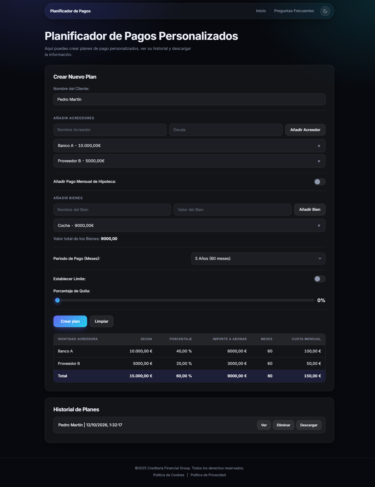

# Planificador de Pagos

Herramienta web para crear **planes de pago personalizados** para clientes con varias deudas. Reparte el valor de los bienes disponibles entre los acreedores de forma proporcional, aplica quitas y límites mensuales, guarda un historial y exporta cada plan a PDF.

Está pensada para despachos de abogados en España que preparan propuestas de pago con unos parámetros habituales (bienes, periodo, cuota máxima) para presentarlas ante un juez dentro de un procedimiento de segunda oportunidad.

**Demo:** https://figueira205.github.io/Planes-de-Pago/



## Qué puedes hacer

- Registrar el **nombre del cliente** y sus **acreedores** con la deuda de cada uno.
- Añadir los **bienes** del cliente; la herramienta suma su valor total.
- Elegir el **periodo de pago** (de 1 a 10 años, o un número de meses a medida).
- Incluir el **pago mensual de la hipoteca**, que se suma a la cuota total.
- Fijar un **límite mensual** de pago que el plan no puede superar.
- Aplicar un **porcentaje de quita** (0 a 100 %) sobre la deuda total.
- Consultar el **historial** de planes, volver a verlos en una ventana y **descargarlos en PDF**.
- Leer la guía completa en la sección de **Preguntas Frecuentes**.

## Cómo funciona el cálculo

1. **Deuda total.** Se suman las deudas de todos los acreedores. Si hay quita, cada deuda se reduce en ese porcentaje.
2. **Valor disponible.** Se toma el menor entre el valor total de los bienes y la deuda con quita (no se paga más de lo que se debe).
3. **Porcentaje de pago.** Valor disponible dividido entre la deuda con quita. Es el porcentaje de su deuda que recibe cada acreedor.
4. **Importe por acreedor.** Deuda con quita del acreedor multiplicada por ese porcentaje.
5. **Cuota mensual.** Importe de cada acreedor dividido entre los meses del plan.
6. **Hipoteca y límite.** Si hay límite mensual, se resta primero la hipoteca. Si las cuotas superan lo que queda, se reducen todas en la misma proporción. Se avisa si la hipoteca ya supera el límite.
7. **Resultado.** Una tabla con deuda, porcentaje, importe, meses y cuota de cada acreedor, y una fila Total.

**Ejemplo.** Banco A debe 10.000 € y Proveedor B 5.000 €. Los bienes valen 9.000 €. El porcentaje de pago es 60 %, así que reciben 6.000 € y 3.000 €. A 60 meses, las cuotas son 100 € y 50 €.

## Estructura del proyecto

| Archivo | Función |
|---|---|
| `index.html` | Formulario del plan, tabla de resultados, historial y ventana modal |
| `faq.html` | Guía de uso con preguntas frecuentes desplegables |
| `script.js` | Lógica de cálculo, historial, modal y exportación a PDF |
| `theme.js` | Interruptor de tema claro y oscuro, que recuerda la elección |
| `style.css` | Sistema de diseño: variables de color, componentes y diseño adaptable |
| `recursos/` | Logotipo y favicon |

## Tecnología

- HTML, CSS y JavaScript sin framework ni paso de compilación.
- [html2canvas](https://html2canvas.hertzen.com/) y [jsPDF](https://github.com/parallax/jsPDF) para generar el PDF en el navegador.
- Tipografía Inter y diseño adaptable a móvil, con tema oscuro por defecto y modo claro opcional.

## Ejecutar en local

```bash
git clone https://github.com/Figueira205/Planes-de-Pago.git
cd Planes-de-Pago
python -m http.server 8000
```

Abre http://localhost:8000. No necesita instalar dependencias.

## Notas

- Los planes del historial viven en la memoria de la página: se pierden al recargar. Descarga el PDF de los que quieras conservar.
- Es una herramienta de apoyo para preparar propuestas. No sustituye el criterio profesional del despacho.
